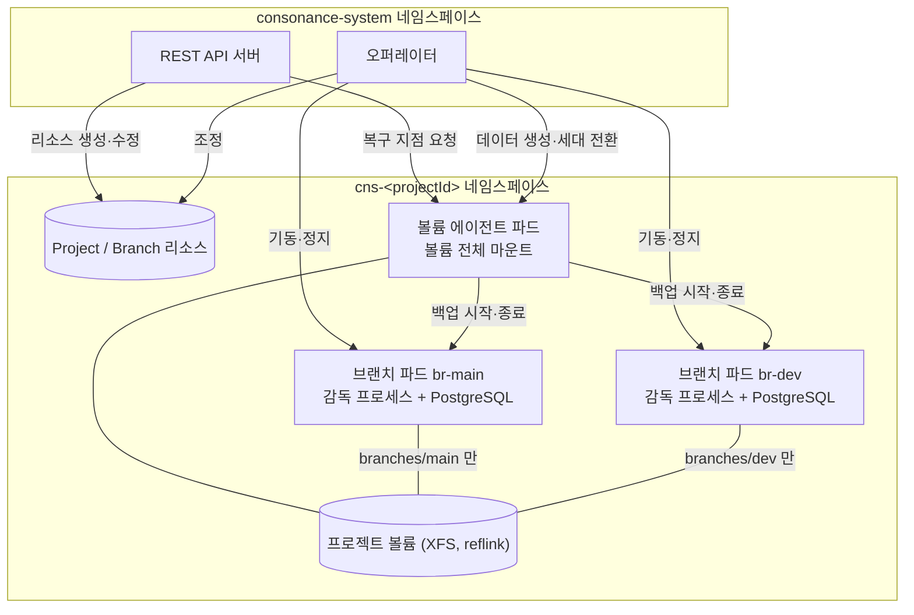
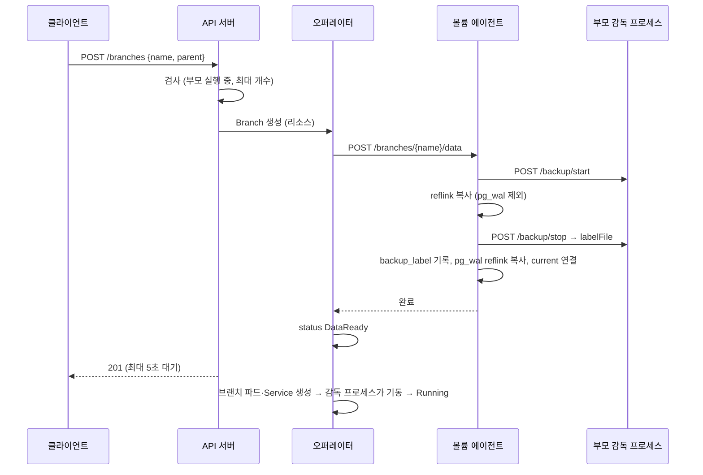

# 브랜칭 엔진 설계 (서브프로젝트 2)

- 작성일: 2026-10-07
- 상태: 설계 승인됨 → 스펙 검토 대기
- 상위 문서: [Consonance PRD & 아키텍처](https://claude.ai/code/artifact/22b5efdd-d2e0-474e-8ad4-53aa06c8c903)
- 근거 측정: `spikes/branching-poc/results/summary.txt` (브랜칭 PoC, 2026-10-07)

## 1. 목표와 범위

쿠버네티스 위에서 프로젝트(main DB)와 브랜치, 복구 지점, 롤백, 정지·기동을 실제로 수행하는 **브랜칭 엔진**을 만든다. 이후 서브프로젝트(연결 게이트웨이, MCP 서버, 웹 콘솔)는 이 엔진의 REST API 위에 올라간다.

**범위 안**

- Project·Branch 쿠버네티스 커스텀 리소스와 이를 조정하는 오퍼레이터
- 프로젝트마다 하나인 볼륨 에이전트 (reflink 복사, 복구 지점, 롤백 세대 관리)
- 브랜치 파드의 감독 프로세스 (PostgreSQL 프로세스 기동·정지, 백업 모드)
- 관리자 API 키로 인증하는 REST API 서버
- 프로젝트별 DB 접속 계정 발급

**범위 밖 (후속 서브프로젝트)**

- WAL 보관과 임의 시각 PITR
- 사용자 계정·조직·토큰, 과금
- 연결 게이트웨이(SNI 라우팅, 풀링, 파괴적 쿼리 가드, 에러 인터셉터), MCP 서버, 웹 콘솔
- 고가용성(동기 대기·자동 장애조치)
- Helm 차트와 설치기 (이번에는 개발용 매니페스트만)
- 확장(extension) 허용 목록

## 2. 전제

| 항목 | 내용 | 출처 |
| --- | --- | --- |
| 실행 기반 | 쿠버네티스만. 특권 권한·커널 모듈 없이 동작 | PRD 결정 1 |
| 스토리지 | 프로젝트마다 XFS 볼륨 1개, 브랜치는 볼륨 안 reflink 사본 | PRD 결정 2, PoC |
| 엔진 | 표준 PostgreSQL 17 | PRD |
| 구현 언어 | Go (오퍼레이터·에이전트·감독 프로세스·API 서버) | PRD 결정 8 |
| 브랜치 생성 방식 | 부모를 백업 모드로 두고 데이터 디렉터리를 reflink 복사 → 백업 종료 → pg_wal reflink 복사 | PoC |
| 깨우기 | 파드는 유지하고 PostgreSQL 프로세스만 재기동 (0.15초 대 파드 재생성 0.71초) | PoC |
| 체크포인트 비용 | 복사마다 원본에 강제 체크포인트 (쓰기 부하 시 P50 0.34~0.39초, 최대 1.7초) → 생성 빈도 제한 | PoC |

## 3. 아키텍처 개요



- **진짜 상태는 쿠버네티스 리소스(Project, Branch)** 에 둔다. 복구 지점만 예외로, 볼륨 에이전트가 볼륨 안 카탈로그에 둔다.
- 쿠버네티스 상태를 바꾸는 주체는 오퍼레이터 하나다. API 서버는 리소스의 spec을 쓰고 status를 읽는다. 단, 복구 지점 생성·삭제·목록은 API 서버가 에이전트를 직접 호출한다(쿠버네티스 상태를 바꾸지 않으므로).
- 계정·조직이 생기는 후속 서브프로젝트에서 PostgreSQL 카탈로그를 API 서버 앞에 추가해 "PostgreSQL 카탈로그 + 쿠버네티스 런타임" 구조로 확장한다.

## 4. 리소스 모델

API 그룹은 가칭 `consonance.io/v1alpha1`이다. 제품명이 확정되면 바꾼다.

### 4.1 네임스페이스

- 시스템: `consonance-system` (오퍼레이터, API 서버)
- 프로젝트: `cns-<projectId>`. `projectId`는 소문자 영숫자 12자 무작위 값이다.
- 프로젝트 네임스페이스에는 Project 1개(이름은 항상 `project`)와 Branch 여러 개가 있다.
- 프로젝트 삭제 = 네임스페이스 삭제.

### 4.2 Project

```yaml
apiVersion: consonance.io/v1alpha1
kind: Project
metadata:
  name: project
  namespace: cns-a1b2c3d4e5f6
spec:
  displayName: my-app
  postgresVersion: "17"
  storage:
    size: 10Gi
    storageClassName: consonance-xfs   # XFS + reflink를 제공해야 함
  defaultCompute:
    cpu: 500m
    memory: 1Gi
  limits:
    maxBranches: 10          # main 포함
    minCopyInterval: 5s      # 같은 원본 브랜치에서 복사(브랜치·복구 지점) 사이 최소 간격
  restorePoints:
    maxPerBranch: 20
    maxAge: 24h
status:
  phase: Ready               # Pending | Provisioning | Ready | Failed
  observedGeneration: 1
  volume:
    pvcName: project-volume
    capacityBytes: 10737418240
    usedBytes: 1105475251
  conditions:                # VolumeReady, AgentReady, ReflinkSupported, MainReady
    - type: ReflinkSupported
      status: "True"
```

### 4.3 Branch

```yaml
apiVersion: consonance.io/v1alpha1
kind: Branch
metadata:
  name: dev-vibe-1           # DNS-1123 label, 최대 40자
  namespace: cns-a1b2c3d4e5f6
spec:
  parent: main               # main 자신은 비워 둔다
  source:
    type: ParentLatest       # ParentLatest | RestorePoint
    restorePointId: ""       # type=RestorePoint일 때만
  protected: false           # main은 기본 true
  state: Running             # Running | Stopped (원하는 PostgreSQL 프로세스 상태)
  compute:                   # 비우면 Project.defaultCompute
    cpu: 500m
    memory: 1Gi
  restore:                   # 롤백·리셋 요청. requestId가 바뀌면 오퍼레이터가 1회 수행
    requestId: ""
    source:
      type: RestorePoint     # RestorePoint | ParentLatest(리셋)
      restorePointId: ""
status:
  phase: Running             # Creating | DataReady | Starting | Running | Stopping | Stopped | Restoring | Failed | Deleting
  dataGeneration: 1
  createdFrom:
    branch: main
    restorePointId: ""
    backupStartLSN: 0/3000028
  endpoint:
    host: br-dev-vibe-1.cns-a1b2c3d4e5f6.svc
    port: 5432
  lastRestore:
    requestId: ""
    phase: ""                # Preparing | Stopping | Activating | Starting | Detaching | Done | Failed
    backupBranch: ""         # 밀려난 세대를 담은 백업 브랜치 이름
  timings:
    dataReadyAt: "2026-10-07T03:15:00.123Z"
    runningAt: "2026-10-07T03:15:00.901Z"
  conditions: []
```

### 4.4 복구 지점 카탈로그

볼륨 에이전트만 쓰는 `/.consonance/catalog.json`. 임시 파일에 쓰고 fsync 후 이름을 바꿔 원자적으로 갱신한다.

```json
{
  "version": 1,
  "restorePoints": [
    {
      "id": "rp-20261007T031500Z-ab12",
      "branch": "main",
      "createdAt": "2026-10-07T03:15:00Z",
      "reason": "api",
      "label": "before schema change",
      "backupStartLSN": "0/3000028",
      "path": "restore/main/rp-20261007T031500Z-ab12"
    }
  ]
}
```

`reason`: `api`(사용자 요청) | `reset`(리셋으로 밀려난 세대를 자동 보관, 9.4). 롤백으로 밀려난 세대는 복구 지점이 아니라 백업 브랜치가 된다.

### 4.5 DB 접속 계정

- 프로젝트마다 일반 권한 역할 `app_owner`와 데이터베이스 `app`을 만든다. 비밀번호(32자 무작위)는 프로젝트 네임스페이스 Secret `db-credentials`에 둔다.
- 브랜치는 데이터 복사로 역할과 비밀번호를 그대로 물려받는다.
- 슈퍼유저 `postgres`는 파드 안 로컬 소켓(peer 인증)으로만 쓴다. `pg_hba.conf`에서 TCP 슈퍼유저 접속은 `reject`, 나머지는 `scram-sha-256`.

## 5. REST API

- 기본 경로 `/v1`, JSON, 인증 헤더 `Authorization: Bearer <관리자 키>`(Secret `consonance-admin-key`).
- 오류는 RFC 9457 `application/problem+json`.
- OpenAPI 3.1 문서를 함께 제공한다(`/v1/openapi.json`).

| 메서드 | 경로 | 동작 | 성공 응답 |
| --- | --- | --- | --- |
| POST | `/v1/projects` | 프로젝트 생성. 본문 `{displayName, storageSize?, compute?}` | 202, 상태 Provisioning |
| GET | `/v1/projects` | 목록 | 200 |
| GET | `/v1/projects/{projectId}` | 상세(상태 포함) | 200 |
| DELETE | `/v1/projects/{projectId}` | 삭제(네임스페이스 삭제) | 202 |
| POST | `/v1/projects/{projectId}/branches` | 브랜치 생성. 본문 `{name, parent?="main", restorePointId?, state?="Running"}` | 201(데이터 준비 완료), 5초 넘으면 202 |
| GET | `/v1/projects/{projectId}/branches` | 목록 | 200 |
| GET | `/v1/projects/{projectId}/branches/{branch}` | 상세 | 200 |
| DELETE | `/v1/projects/{projectId}/branches/{branch}` | 삭제. main은 409 | 202 |
| GET | `/v1/projects/{projectId}/branches/{branch}/connection` | `{host, port, database, user, password, uri}` | 200 |
| POST | `/v1/projects/{projectId}/branches/{branch}/stop` | 정지 | 200, 10초 넘으면 202 |
| POST | `/v1/projects/{projectId}/branches/{branch}/start` | 기동 | 200, 10초 넘으면 202 |
| POST | `/v1/projects/{projectId}/branches/{branch}/reset` | 부모 최신 상태로 리셋. main은 409 | 200, 30초 넘으면 202 |
| POST | `/v1/projects/{projectId}/branches/{branch}/rollback` | 본문 `{restorePointId}`. 응답에 `backupBranch` | 200, 30초 넘으면 202 |
| POST | `/v1/projects/{projectId}/branches/{branch}/restore-points` | 본문 `{label?}` | 201 |
| GET | `/v1/projects/{projectId}/branches/{branch}/restore-points` | 목록 | 200 |
| DELETE | `/v1/projects/{projectId}/branches/{branch}/restore-points/{restorePointId}` | 삭제 | 204 |

**오류 유형**

| HTTP | `type` | 경우 |
| --- | --- | --- |
| 400 | `validation-error` | 이름 형식, 필드 누락 |
| 401 | `unauthorized` | 관리자 키 없음·불일치 |
| 404 | `not-found` | 프로젝트·브랜치·복구 지점 없음 |
| 409 | `conflict` | 이름 중복, main 삭제·리셋 시도, 부모가 실행 중이 아님, 프로젝트가 Ready가 아님(reflink 미지원 등으로 실패한 프로젝트 포함), 프로젝트 작업 잠금 대기 초과 |
| 429 | `rate-limited` | 브랜치 최대 개수, 최소 복사 간격 위반 (`Retry-After` 포함) |
| 507 | `insufficient-storage` | 볼륨 사용률 90% 초과 |
| 500 | `internal` | 그 밖의 실패 (`detail`에 원인) |

## 6. 볼륨 레이아웃과 세대

```
/                               볼륨 루트 (에이전트만 전체 마운트)
├── branches/
│   ├── main/                   main 파드는 이 디렉터리만 마운트 (subPath)
│   │   ├── current -> data-3   감독 프로세스가 기동할 때 읽는 현재 세대 (상대 심볼릭 링크)
│   │   └── data-3/             PostgreSQL 데이터 디렉터리
│   └── dev-vibe-1/
│       ├── current -> data-1
│       └── data-1/
├── restore/
│   └── main/rp-<시각>-<id>/    복구 지점 = reflink 사본 (backup_label 포함, 그대로 기동 가능)
└── .consonance/
    └── catalog.json
```

- 파드에 subPath로 붙인 디렉터리는 이름을 바꿔도 파드가 옛 디렉터리를 계속 본다. 그래서 디렉터리를 통째로 바꾸지 않고, 같은 브랜치 디렉터리 안에 새 세대 `data-N`을 만든 뒤 `current` 링크만 바꾼다.
- 링크 전환은 `current.tmp`를 만든 뒤 `rename`으로 원자적으로 한다.
- 복사 중인 디렉터리에는 `.incomplete` 파일을 두고 끝나면 지운다. 에이전트는 기동할 때 `.incomplete`가 남은 디렉터리를 지운다.

## 7. 구성 요소 상세

### 7.1 오퍼레이터 (`cmd/operator`, `internal/controller`)

controller-runtime 기반. 모든 조정 단계는 멱등이다.

**Project 조정**

1. Secret `db-credentials`(없을 때만 생성), Secret `internal-token`(에이전트·감독 프로세스 간 인증), NetworkPolicy, ResourceQuota를 맞춘다.
2. PVC `project-volume`(RWO, `spec.storage`)을 만든다.
3. 에이전트 파드 `volume-agent`를 띄운다(Project가 소유).
4. 에이전트 `GET /v1/preflight`로 reflink 지원을 확인한다. 실패하면 `ReflinkSupported=False`(이유 `ReflinkUnsupported`), phase Failed.
5. main Branch가 없으면 만들고, 에이전트 `POST /v1/init-main`으로 `branches/main/data-1`을 초기화한다. main의 데이터는 여기서만 만든다.
6. main이 처음 Running이 되면 감독 프로세스 `POST /v1/bootstrap`을 호출해 접속 계정을 만들고 `MainReady=True`로 둔다. 이미 있으면 건너뛰므로 다시 호출해도 안전하다.
7. 모든 조건이 참이면 phase Ready.

**Branch 조정**

1. main이 아닌 브랜치의 데이터 디렉터리가 없으면 에이전트 `POST /v1/branches/{name}/data`를 호출한다. 성공하면 status `DataReady`, `dataReadyAt` 기록.
2. 브랜치 파드 `br-<name>`과 Service `br-<name>`을 맞춘다(Branch가 소유). 파드가 사라지면 다시 만든다.
3. `spec.state`와 감독 프로세스 상태가 다르면 `POST /v1/start` 또는 `/v1/stop`을 호출한다.
4. `spec.restore.requestId`가 `status.lastRestore.requestId`와 다르면 9.4의 롤백·리셋 절차를 단계별로 진행하고, 단계마다 `status.lastRestore.phase`를 기록한다(중간에 오퍼레이터가 재시작해도 이어서 진행).
5. 삭제 시 파이널라이저에서 파드·Service를 지우고 에이전트 `DELETE /v1/branches/{name}/data`를 호출한 뒤 파이널라이저를 뗀다.

### 7.2 볼륨 에이전트 (`cmd/agent`, `internal/volume`)

프로젝트당 파드 1개. 볼륨 루트를 `/volume`에 마운트한다. 내부 HTTP API(포트 8443, 헤더 `X-Consonance-Token`).

| 엔드포인트 | 동작 |
| --- | --- |
| `GET /v1/preflight` | 볼륨에서 시험 파일을 `FICLONE`으로 복제해 reflink 지원 확인, 커널 버전 보고 |
| `POST /v1/init-main` | `initdb`로 `branches/main/data-1` 생성, `current` 연결 |
| `POST /v1/branches/{name}/data` | 본문 `{parent, source}`. 부모 감독 프로세스 백업 시작 → reflink 복사(pg_wal·postmaster.pid·postmaster.opts 제외) → 백업 종료(backup_label 기록) → pg_wal reflink 복사 → `current` 연결. 출처가 복구 지점이면 복구 지점 디렉터리를 reflink 복사 |
| `DELETE /v1/branches/{name}/data` | 브랜치 디렉터리와 그 브랜치의 복구 지점 삭제 |
| `POST /v1/branches/{name}/restore-points` | 본문 `{label, reason}`. 같은 백업 모드 복사를 `restore/`에 하고 카탈로그에 추가, 보존 정책으로 오래된 것 정리 |
| `GET /v1/branches/{name}/restore-points` | 목록 |
| `DELETE /v1/branches/{name}/restore-points/{id}` | 삭제 |
| `POST /v1/branches/{name}/generations` | 본문 `{source}`. 새 세대 `data-N+1`을 만들지만 활성화하지 않음 |
| `POST /v1/branches/{name}/generations/{n}/activate` | 브랜치가 정지된 상태에서 `current`를 `data-n`으로 전환 |
| `POST /v1/branches/{name}/generations/{n}/detach` | 본문 `{toBranch}`. `data-n`을 `branches/<toBranch>/data-1`로 옮기고 `current` 연결 |
| `GET /v1/usage` | 볼륨 사용량 |

- 볼륨을 바꾸는 작업은 프로젝트 안에서 한 번에 하나만 한다. 잠금 대기가 2초를 넘으면 409.
- 같은 원본 브랜치에서의 복사(브랜치·복구 지점)는 직전 복사가 **끝난 시각**부터 `minCopyInterval`이 지나야 한다. 어기면 429와 남은 시간. 복구 지점에서 브랜치를 만드는 복사는 원본 DB에 체크포인트를 걸지 않으므로 이 제한을 받지 않는다.
- 볼륨 사용률(statfs 기준) 90% 초과 시 복사 작업은 507.
- 복구 지점 보존 정책(`maxPerBranch`, `maxAge`)은 복구 지점을 만들 때와 1시간마다 적용해 오래된 것부터 지운다.

### 7.3 브랜치 감독 프로세스 (`cmd/supervisor`, `internal/pgctl`)

브랜치 파드의 PID 1. PostgreSQL(postmaster)을 자식으로 띄우고, 고아 프로세스를 거둔다. 내부 HTTP API(포트 8008, 헤더 `X-Consonance-Token`).

| 엔드포인트 | 동작 |
| --- | --- |
| `GET /healthz` | 감독 프로세스 생존 (liveness) |
| `GET /readyz` | PostgreSQL이 접속을 받으면 200 (readiness). 정지 상태면 503 |
| `GET /v1/status` | `{pg: running/stopped/starting/stopping, generation, since}` |
| `POST /v1/start` | `/pgdata/current`로 PostgreSQL 기동, 접속 가능까지 대기 |
| `POST /v1/stop` | fast shutdown, 30초 안에 끝나지 않으면 immediate |
| `POST /v1/backup/start` | 본문 `{label}`. 로컬 소켓 세션을 열어 `pg_backup_start(label, true)`, 세션 유지. 30초 안에 종료가 오지 않으면 세션을 닫아 백업 취소 |
| `POST /v1/backup/stop` | 같은 세션에서 `pg_backup_stop(false)`, `{labelFile, stopLSN}` 반환 |
| `POST /v1/bootstrap` | main 첫 기동 시 `app_owner` 역할과 `app` DB 생성(이미 있으면 건너뜀) |

- 기동 옵션은 매번 명령행 `-c`로 준다: `port=5432`, `listen_addresses='*'`, `unix_socket_directories='/var/run/postgresql'`, `shared_buffers`=메모리 한도의 25%(Downward API로 받은 컨테이너 메모리 한도 기준), `max_connections=100`. 데이터 디렉터리의 설정 파일에 기대지 않아 사본 간 설정이 섞이지 않는다.
- 모든 엔드포인트는 이미 원하는 상태면 아무것도 하지 않고 200을 돌려준다(이미 실행 중일 때 `start`, 이미 정지했을 때 `stop`, 계정이 있을 때 `bootstrap`).
- SIGTERM을 받으면 PostgreSQL을 fast shutdown한 뒤 종료한다.

### 7.4 REST API 서버 (`cmd/apiserver`, `internal/httpapi`)

- Go 표준 `net/http` 라우팅. 상태가 없고 여러 개 띄울 수 있다.
- 쿠버네티스 리소스는 controller-runtime 클라이언트(캐시 사용)로 쓰고 읽는다.
- 동기 응답이 필요한 요청은 해당 Branch status를 watch로 기다리고, 제한 시간(5장 표)을 넘으면 202와 현재 상태를 돌려준다.

### 7.5 파드 명세 공통

- 모든 파드: `runAsNonRoot`, uid/gid 999, `allowPrivilegeEscalation: false`, capabilities 전부 제거, seccomp `RuntimeDefault` → 쿠버네티스 Pod Security Standard `restricted` 충족.
- 에이전트 파드: `fsGroup: 999`, `fsGroupChangePolicy: OnRootMismatch`(대용량 볼륨에서 재귀 chown 방지). 자원 100m/128Mi.
- 브랜치 파드: 볼륨 subPath `branches/<name>` → `/pgdata`, emptyDir → `/var/run/postgresql`, Secret `internal-token`, main만 Secret `db-credentials`. 자원은 Branch compute.
- 같은 PVC(RWO)를 쓰므로 브랜치 파드는 에이전트 파드와 같은 노드에 둔다(필수 podAffinity, `kubernetes.io/hostname`).

### 7.6 이미지

| 이미지 | 내용 |
| --- | --- |
| `consonance/postgres:17` | 공식 `postgres:17` + 감독 프로세스 바이너리, ENTRYPOINT=감독 프로세스 |
| `consonance/agent` | 에이전트 바이너리 + PostgreSQL 17 클라이언트 도구(`initdb` 포함) |
| `consonance/operator` | 오퍼레이터 바이너리 |
| `consonance/apiserver` | API 서버 바이너리 |

## 8. 네트워크 정책 (프로젝트 네임스페이스)

- 기본: 모든 인바운드 거부.
- 브랜치 파드 5432: `consonance-system` 네임스페이스와 에이전트 파드에서만 허용.
- 브랜치 파드 8008(감독 프로세스): `consonance-system`의 오퍼레이터와 에이전트 파드에서만 허용.
- 에이전트 파드 8443: `consonance-system`의 오퍼레이터와 API 서버에서만 허용.
- 브랜치 파드 아웃바운드: 모두 거부(PostgreSQL은 밖으로 나갈 일이 없다). 에이전트 아웃바운드: 같은 네임스페이스와 DNS만 허용.

## 9. 주요 흐름

### 9.1 프로젝트 생성 (비동기)

1. API 서버가 `projectId`를 만들고 네임스페이스 `cns-<projectId>`와 Project를 만든다 → 202.
2. 오퍼레이터가 7.1 Project 조정 순서대로 진행한다.
3. main 파드가 처음 Running이 되면 오퍼레이터가 감독 프로세스 `/v1/bootstrap`을 호출해 접속 계정을 만든다.
4. Project phase Ready. 생성 소요 시간을 메트릭으로 남긴다.

### 9.2 브랜치 생성 (데이터 준비까지 동기)



### 9.3 복구 지점 생성 (동기)

API 서버 → 에이전트 `POST /v1/branches/{b}/restore-points`. 브랜치 생성과 같은 백업 모드 복사를 `restore/<b>/`에 한다 → 201.

### 9.4 롤백·리셋 (동기, 최대 30초 대기)

API 서버가 `spec.restore`에 새 `requestId`와 출처를 쓰면 오퍼레이터가 단계별로 진행한다.

1. **Preparing:** 에이전트 `POST /generations`로 새 세대를 만든다. 롤백이면 복구 지점 사본, 리셋이면 부모의 현재 상태(백업 모드 복사).
2. **Stopping:** 감독 프로세스 `/v1/stop`.
3. **Activating:** 에이전트 `/generations/{n}/activate`로 `current` 전환.
4. **Starting:** 감독 프로세스 `/v1/start`. 실패하면 `current`를 옛 세대로 되돌리고 다시 기동한 뒤 phase Failed.
5. **Detaching:** 롤백이면 옛 세대를 백업 브랜치로 옮기고 그 Branch를 `state: Stopped`로 만든다. 백업 브랜치 이름은 `<브랜치 이름 앞 18자>-before-<UTC yyyymmddhhmmss>`(최대 40자, 예: `main-before-20261007031500`)다. 리셋이면 옛 세대를 복구 지점(`reason: reset`)으로 옮긴다.
6. **Done:** `status.lastRestore`에 결과(`backupBranch` 포함) 기록.

연결 문자열은 바뀌지 않는다. 진행 중 기존 연결은 끊긴다.

### 9.5 정지·기동

API 서버가 `spec.state`를 바꾸면 오퍼레이터가 감독 프로세스를 호출한다. 파드와 볼륨은 그대로다.

### 9.6 브랜치 삭제

main은 삭제할 수 없다(API 409). 그 밖의 브랜치는 파이널라이저 절차(7.1 Branch 조정 5)로 지운다. reflink 사본은 서로 독립적이라 부모를 지워도 자식 브랜치는 영향받지 않는다.

## 10. 오류 처리와 일관성

| 상황 | 처리 |
| --- | --- |
| 복사 중 에이전트 종료 | `.incomplete` 표시 디렉터리를 다음 기동 때 지우고, 오퍼레이터 재시도로 다시 복사 |
| 백업 시작 후 종료 요청이 오지 않음 | 감독 프로세스가 30초 뒤 세션을 닫아 PostgreSQL이 백업을 취소 |
| 롤백 새 세대 기동 실패 | `current`를 옛 세대로 되돌리고 재기동, `lastRestore.phase=Failed` |
| 오퍼레이터 재시작 | 상태를 리소스 status에서 다시 읽어 이어서 진행 (`lastRestore.phase` 기준) |
| 일시적 오류 (에이전트·감독 프로세스 응답 없음) | 지수 백오프 재시도 |
| 영구적 오류 (reflink 미지원, 디스크 부족, 부모 없음) | phase Failed, 조건과 이유 기록, API가 해당 오류 유형으로 반환 |

## 11. 관측

- 로그: `log/slog` JSON. 공통 필드 `projectId`, `branch`, `requestId`, `op`.
- 메트릭(Prometheus): `consonance_branch_create_seconds`, `consonance_branch_first_ready_seconds`, `consonance_restore_seconds`, `consonance_start_seconds`, `consonance_project_create_seconds`, `consonance_copy_errors_total`.

## 12. 테스트

| 수준 | 대상 | 방법 |
| --- | --- | --- |
| 단위 | `internal/volume` | 실제 XFS(reflink) 디렉터리에서. 환경 변수 `CONSONANCE_TEST_XFS_DIR`가 없으면 건너뜀 |
| 단위 | `internal/pgctl` | 실제 PostgreSQL 17 바이너리로 백업 모드·기동·정지 검증 |
| 단위 | `internal/httpapi` | controller-runtime 가짜 클라이언트 + 가짜 에이전트 클라이언트 |
| 조정 로직 | `internal/controller` | envtest + 가짜 에이전트·감독 프로세스 클라이언트 |
| E2E | 전체 | Lima VM의 k3s에 이미지를 올리고 시나리오 실행 |
| 성능 | 전체 | E2E 환경에서 20회, 부하 없음·pgbench 쓰기 부하 두 조건 |

E2E 시나리오: 프로젝트 생성 → 브랜치 생성 → 브랜치에 쓰기 → main 불변 확인 → 복구 지점 → 테이블 삭제 → 롤백 → 데이터 복원 확인 → 정지·기동 → 브랜치 삭제 → 프로젝트 삭제.

구현은 TDD로 진행한다.

## 13. 저장소 구조

```
consonance/
├── api/v1alpha1/            Project·Branch 타입
├── cmd/{operator,agent,supervisor,apiserver}/
├── internal/
│   ├── controller/          Project·Branch 조정
│   ├── volume/              reflink 복사, 세대, 카탈로그
│   ├── pgctl/               PostgreSQL 프로세스·백업 모드
│   ├── agentclient/
│   ├── supervisorclient/
│   └── httpapi/             REST 핸들러, problem+json, OpenAPI
├── config/                  CRD·RBAC·개발용 매니페스트 (kustomize)
├── images/                  Dockerfile 4종
├── test/e2e/, test/perf/
├── spikes/branching-poc/    (버릴 코드, 참고용)
└── docs/superpowers/specs/
```

- Go 1.25 이상, 모듈 하나.
- Make 대상: `test`, `test-xfs`(VM), `images`, `deploy-dev`(k3s), `e2e`, `perf`.

## 14. 기본값

| 항목 | 값 |
| --- | --- |
| 볼륨 크기 | 10Gi |
| 브랜치 컴퓨트 | 500m CPU / 1Gi |
| 브랜치 최대 개수 | 10 (main 포함) |
| 최소 복사 간격 | 5초 (원본 브랜치마다) |
| 복구 지점 보존 | 브랜치당 20개, 24시간 |
| 백업 세션 제한 시간 | 30초 |
| API 동기 대기 | 브랜치 생성 5초, 정지·기동 10초, 롤백·리셋 30초 |
| 에이전트 잠금 대기 | 2초 |
| 복사 거부 사용률 | 90% |

## 15. 완료 기준

1. E2E 시나리오가 k3s에서 통과한다.
2. 성능(20회, 부하 없음과 쓰기 부하 각각): 브랜치 생성 API P50 1초 이하, 새 브랜치 첫 쿼리 P95 3초 이하, 롤백 10초 이하, 정지 → 실행 P50 1초 이하.
3. 프로젝트 생성 시간을 측정해 기록한다.
4. 모든 파드가 Pod Security Standard `restricted`로 실행된다.
5. OpenAPI 문서가 생성된다.

## 16. 열린 질문

- API 그룹·도메인 이름은 제품명 확정 후 정한다.
- OpenShift의 임의 UID 정책 대응은 설치 서브프로젝트에서 검증한다.
- 클라우드 볼륨에서 프로젝트 생성이 10초를 넘으면 '미리 만들어 둔 프로젝트 풀'을 후속 과제로 둔다.
